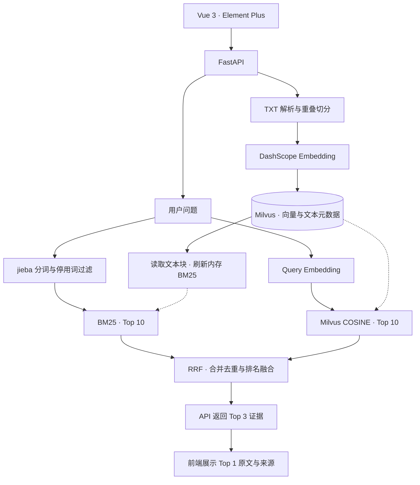

# Enterprise RAG

### 从关键词匹配到语义理解，让企业知识检索拥有两种视角。

**Hybrid Retrieval · Reciprocal Rank Fusion · Vector Search · Traceable Sources**

基于 **FastAPI + Milvus + DashScope + Vue 3** 构建的企业知识库检索原型。打通文档导入、重叠切分、向量入库、双路召回与排名融合，以 **BM25 词法检索 + Dense Vector 语义检索 + RRF 融合排序** 构建 RAG 的检索核心。

不止于“把问题转成向量后查数据库”：让关键词命中与语义相似互为补充，再用统一的排名机制选择证据。

> 当前聚焦 Retrieval：返回可追溯的原文证据，前端展示 Top 1。尚未接入生成式回答，可作为后续 Retrieval-Augmented Generation 的检索底座。

## 核心亮点

- **双路召回，融合决策**：BM25 捕获术语和关键词，向量检索补充语义关联，RRF 汇聚两路排名。
- **基于排名，而非硬拼分数**：不直接相加 BM25 与余弦相似度，避免混用不同尺度的原始得分。
- **完整知识入库链路**：文档解析 → 重叠切分 → 分批 Embedding → Milvus 写入 → 内存 BM25 索引刷新。
- **检索结果可追溯**：保留原文、来源、双路排名、原始得分及融合分数，便于分析“为什么这条排在前面”。
- **显式向量校验**：检查数量、返回索引和维度，减少文本与向量错位进入检索链路的风险。
- **前后端解耦**：Vue 3 + Element Plus 负责交互，FastAPI 提供服务，Vite 在开发环境代理 API。

## 技术架构



两路召回逻辑独立，当前代码顺序执行，尚未实现并行召回。BM25 在 Python 内存中计算，向量检索由 Milvus 完成。

## 检索核心：BM25 × Dense Vector × RRF

### 01 / 词法召回：抓住关键术语

文档与问题共用英文小写转换、jieba 中文分词、停用词和空白标点过滤逻辑，使用 `rank-bm25` 的 `BM25Okapi` 计算相关性。

实现中检查问题词与文档词的交集，而不是简单使用 `BM25 score > 0` 判断命中：小语料下，BM25 分数可能为零或负数，不能仅凭正负过滤候选。

### 02 / 语义召回：补充字面之外的关联

通过 DashScope `MultiModalEmbedding` 接口将文档与问题转为稠密向量，由 Milvus 执行 **COSINE 相似度检索**。

例如，“出差回来怎么报账？”与“差旅费用报销申请”的字面并不完全一致，语义召回旨在补充这类关联。这是设计动机示例，不是已完成的效果评测结论。当前仅使用模型的文本输入能力，未实现图片或视频检索。

### 03 / RRF：用排名融合异构检索结果

**RRF（Reciprocal Rank Fusion，倒数排名融合）** 是双路检索的汇合点。

BM25 与余弦相似度的分数尺度不同。RRF 不直接相加原始得分，而是使用每条候选在各路结果中的名次进行融合：

$$
\operatorname{RRF}(d)=\sum_{r\in\{\mathrm{BM25},\mathrm{Dense}\}}\frac{\mathbf{1}[d\in L_r]}{k+\operatorname{rank}_r(d)}
$$

- 排名从 1 开始；某一路没有召回该文档时，该路贡献为 0。
- 当前 `k = 60`，两路等权，每路最多召回 10 条。
- 按文档块 ID 合并去重，累加两路排名贡献。
- 按融合分数降序排列，同分时按 ID 升序，保证确定的排序顺序。
- 后端返回 Top 3，前端展示 Top 1。

**一个直观的融合示例：**

| 文本块 | BM25 排名 | 向量排名 | RRF 分数（k=60） | 融合名次 |
| --- | ---: | ---: | ---: | ---: |
| A | 1 | 3 | 1/61 + 1/63 ≈ 0.032266 | 2 |
| B | 2 | 1 | 1/62 + 1/61 ≈ 0.032522 | 1 |
| C | 未召回 | 2 | 1/62 ≈ 0.016129 | 3 |

B 虽然不是 BM25 第一名，但两路综合表现更靠前，因此融合后排在第一。这体现了 RRF 对多路共同支持的利用。

核心实现位于 [`backend/hybrid_search.py`](backend/hybrid_search.py)。合并记录初始化后，计分核心为：

```python
for rank, hit in enumerate(hits, start=1):
    row = merged[hit["id"]]
    row["rrf_score"] += 1.0 / (RRF_K + rank)
    row[f"{route}_rank"] = rank
    row[f"{route}_score"] = hit["score"]
```

> RRF 是排名融合，不是 Cross-Encoder 语义重排，也不是答案置信度。双路召回提供互补机制，但是否优于单路仍需真实评测集验证，当前不宣称未经测量的准确率提升。

## 知识入库：不仅存向量，也保留证据

| 环节 | 当前实现 | 设计目的 |
| --- | --- | --- |
| 文本解析 | UTF-8 / UTF-8 BOM，统一换行，按空行分段 | 保留自然段边界 |
| 长段切分 | 每块最多 200 字符，重叠 30 字符 | 减少边界处的上下文割裂 |
| 向量生成 | 每批 10 个文本块，外部 Embedding API | 控制单批请求规模 |
| 响应校验 | 按 index 还原顺序，校验数量、索引与维度 | 保证文本与向量对应 |
| 数据存储 | id、text、source、vector | 绑定语义表示与可展示证据 |
| 索引刷新 | 写入后读取文本，重建内存 BM25 | 更新当前进程的词法检索视图 |

先完成全部文本块的向量生成，再开始写入；写入期间将索引标记为未就绪，直到 BM25 刷新成功。失败后，后续请求会尝试重新读取数据库恢复索引状态。该机制不是数据库事务，不保证失败自动回滚。

## 技术栈

| 层级 | 技术 | 职责 |
| --- | --- | --- |
| 用户界面 | Vue 3 · Composition API · Element Plus | 上传、查询、状态反馈、原文证据展示 |
| 前端工程 | Vite · Fetch API | 开发构建、API 代理与请求封装 |
| API 服务 | FastAPI · Pydantic · Uvicorn | 请求校验、生命周期管理、REST 接口 |
| 向量模型 | Alibaba Cloud DashScope | 文档与问题的 Dense Embedding |
| 向量数据库 | Milvus · PyMilvus | 向量存储、元数据与 COSINE 检索 |
| 词法检索 | jieba · rank-bm25 | 中文分词与 BM25 相关性计算 |
| 融合算法 | Reciprocal Rank Fusion | 候选去重、排名聚合与截断 |
| 配置管理 | python-dotenv | 环境配置与后端密钥隔离 |

## 工程设计细节

- **生命周期管理**：服务启动时连接 Milvus、检查集合维度并加载索引，退出时关闭连接。
- **分批读取语料**：利用 Milvus 查询迭代器读取文本和来源，不拉取全部向量构建 BM25。
- **单进程并发保护**：上传与查询通过锁串行处理，避免在索引刷新期间查询。
- **融合行为可解释**：保留 `bm25_rank`、`vector_rank`、双路原始分数与 `rrf_score`，便于调试排序。
- **安全呈现原文**：使用 Vue 文本插值，不直接将上传内容当作 HTML 渲染；模型密钥只保留在后端。
- **非破坏性初始化**：空集合初始化脚本检查已有集合维度，不覆盖已有记录。

## 演进方向

以下是后续计划，**尚未实现**：

- 带来源引用的 LLM 回答生成，补全 Retrieval → Augmentation → Generation 链路。
- Cross-Encoder Reranker，对融合候选进一步做相关性重排。
- 标注评测集与 Recall@K、MRR、nDCG 对比，验证单路及融合检索效果。
- PDF / Markdown 解析、文档版本管理和增量索引更新。
- 用户鉴权、租户隔离、异步入库任务与生产级并发控制。

## 目录

```text
enterprise-rag/
├── backend/
│   ├── app.py                 # FastAPI 上传与查询
│   ├── embedding_model.py     # DashScope 向量模型
│   ├── hybrid_search.py       # BM25、向量检索、RRF
│   ├── init_collection.py     # 创建空集合，不调用模型
│   ├── milvus_demo.py         # 原始学习入库脚本（有覆盖风险）
│   ├── text.py                # 模型调用练习
│   ├── data.txt               # 虚构员工手册样例
│   ├── .env.example
│   └── requirements.txt
└── frontend/
    ├── src/App.vue            # 页面与交互
    ├── src/api.js             # 请求与错误处理
    ├── vite.config.js         # 开发反向代理
    └── package-lock.json
```

## 本地启动（Windows PowerShell）

<details>
<summary>展开环境配置与运行步骤</summary>

准备 Python 3.11+（原项目环境为 3.13）、Node.js 22.12+ 或 24，以及已经启动的 Milvus。当前依赖沿用原项目 PyMilvus 3.0.x；请使用与客户端兼容的 Milvus 服务端。本仓库不包含 Docker 数据卷，也不自动安装或启动数据库。

### 1. 配置后端

在仓库根目录执行：

```powershell
cd backend
python -m venv .venv
.\.venv\Scripts\python.exe -m pip install -r requirements.txt
Copy-Item .env.example .env
```

编辑 `backend/.env` 填入自己的密钥，确认模型、地域 URL、维度与实际开通服务一致。不要提交 `.env`。已有集合的模型和维度必须保持一致；更换模型需重新构建索引。

### 2. 初始化集合并启动 API

Milvus 必须先在 `127.0.0.1:19530` 可连接：

```powershell
.\.venv\Scripts\python.exe init_collection.py
.\.venv\Scripts\python.exe -m uvicorn app:app --host 127.0.0.1 --port 8000
```

初始化脚本只创建不存在的 `rag_test_v1` 空集合；已有集合只检查向量维度，不删除或重写数据。API 文档：http://127.0.0.1:8000/docs 。首次启动可使用空集合，再通过前端上传样例。

### 3. 启动前端

另开终端，从仓库根目录执行：

```powershell
cd frontend
npm.cmd ci
npm.cmd run dev
```

访问 http://127.0.0.1:5173 。使用 `npm.cmd` 可避免 PowerShell 拦截 `npm.ps1`，无需修改系统执行策略。端口占用时先检查是否已有服务，勿重复启动。

前端 `/api/*` 由 Vite 原样代理至 `http://127.0.0.1:8000/api/*`。更换后端端口时修改 `frontend/vite.config.js` 的 target。

</details>

## 试用与接口

1. 上传 `backend/data.txt`（虚构资料），等待切分、向量化、写入及 BM25 刷新成功。
2. 查询“年假需要提前多久申请？”，应能检索到相关原文；具体排序取决于模型及语料。

| 接口 | 请求 | 返回 |
| --- | --- | --- |
| POST /api/documents | multipart/form-data，字段 file | filename、chunks、total_chunks、message |
| POST /api/query | JSON：{"question":"年假如何申请？"} | question、answer:null、sources |

上传仅支持 UTF-8 TXT，最大 200KB、200 个文本块；同名文档返回 409，不支持覆盖。问题最多 200 字符。后端返回融合后的多条 sources，前端只显示 sources[0]。失败不自动重试：若写入中途失败，应先检查数据库是否已有部分数据。

**勿对已有数据直接运行旧版 `milvus_demo.py`**：它从 ID=1 开始 upsert，可能覆盖相同 ID。该脚本仅作为学习材料保留；正常流程用 `init_collection.py` + 网页上传。

## 安全与边界

- 文档和问题会发送到配置的外部向量服务，可能产生费用；请勿上传未授权敏感资料。
- 未实现登录鉴权、用户隔离、生产级并发写入、删除更新、任务队列或限流。不要直接暴露到公网。
- 后端仅用单进程锁，并在内存维护 BM25；请单 worker 运行，不使用多 worker。
- 改动向量模型时，即使维度相同，也不能直接混用旧向量。
- 默认 `.gitignore` 排除密钥、依赖、虚拟环境、构建产物和数据卷。不要使用 `git add -f` 强行提交敏感文件。
- 若密钥曾出现在截图、日志或历史提交中，应在服务商控制台撤销并换新；删除文件不等于消除已泄露的密钥。
- 本包不含数据库记录、原项目 .env、Git 历史或实际密钥，仅包含源码和虚构样例。

## 构建与 GitHub

<details>
<summary>展开构建与提交说明</summary>

```powershell
cd frontend
npm.cmd run build
```

产物为 frontend/dist。Vite 代理只在开发时生效，生产部署需另配 Nginx 等反向代理，并补齐上述安全能力。Element Plus 全量引入可能产生包体积警告。

在 GitHub 创建空仓库后，在本项目根目录手动执行（将占位地址换成自己的仓库）：

```powershell
git init
git add .
git status
git diff --cached --stat
# 确认没有 .env、密钥、真实文档后再提交
git commit -m "Initial RAG demo"
git branch -M main
git remote add origin https://github.com/YOUR_NAME/YOUR_REPO.git
git push -u origin main
```

尚未指定开源许可证，因此本包没有自动添加 LICENSE；公开前请自行决定许可，并核对引用来源与第三方许可。

</details>
